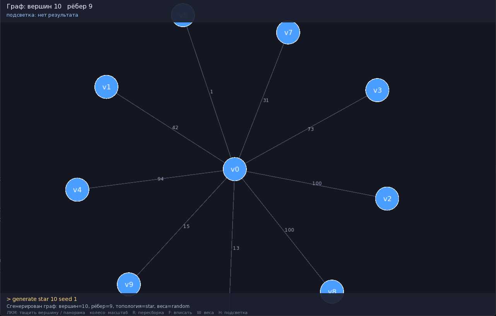

# Алгоритмы поиска на графах (Лабораторная работа №3)

Репозиторий содержит реализацию лабораторной работы №3 по курсу «Информатика (организация и поиск данных)» в НИЯУ МИФИ. Проект представляет собой комплекс графовых алгоритмов на неориентированных взвешенных графах с интерактивным консольным интерфейсом, **нативным графическим окном на SFML с живым обновлением**, дополнительной визуализацией в браузере и системой бенчмарков с выгрузкой результатов в CSV.

## Основные возможности

### Слой данных
Неориентированный взвешенный граф на списках смежности. Вершины могут иметь строковые имена. Веса поддерживают целые и вещественные числа (принцип общности). Корректно обрабатываются петли и параллельные рёбра. Полный жизненный цикл редактирования: создание, добавление, **удаление вершин и рёбер**, удаление графа целиком.

### Алгоритмы кратчайших путей
- **Обход в ширину (BFS)** — кратчайшие пути в невзвешенном графе за O(V + E);
- **Дейкстра** — взвешенные графы с неотрицательными весами за O((V + E) log V), реализация с ленивым удалением из очереди с приоритетами;
- **Форд-Беллман** — взвешенные графы за O(V·E), с обнаружением отрицательных циклов и ранней остановкой.

### Алгоритмы минимального остова
- **Крускал** — через систему непересекающихся множеств со сжатием путей и объединением по рангу; сортировка рёбер выполняется собственной бинарной кучей, что даёт гарантированное O(E log E) без деградации на упорядоченных данных;
- **Прим** — через очередь с приоритетами;
- оба алгоритма корректно строят **остовный лес** для несвязных графов и допускают отрицательные веса.

### Обходы и компоненты связности
Итеративные реализации обхода в глубину и в ширину на явном стеке/очереди — без переполнения стека вызовов на глубоких графах (проверено тестом на цепочке из 50 000 вершин).

### Генератор графов
Шесть топологий (случайный граф Эрдёша-Реньи, кольцо, путь, звезда, полный граф, случайное дерево) и три распределения весов (по возрастанию, по убыванию, случайное) — закрывает требование методички о трёх случаях входных данных. Детерминированность по зерну обеспечивает воспроизводимость бенчмарков.

### Вспомогательные структуры данных
- бинарная куча-минимум для Дейкстры, Прима и сортировки рёбер в Крускале;
- система непересекающихся множеств для Крускала;
- кольцевой буфер для обхода в ширину.

### Бенчмарки
Измерение времени, сравнение нескольких алгоритмов на одном графе, полный прогон по всем топологиям и распределениям весов (75 результатов), выгрузка в CSV.

### Парсер команд
Разбор текстовых команд в абстрактное синтаксическое дерево, поддержка строковых литералов в кавычках, комментариев и регистронезависимых ключевых слов.

## Два режима визуализации

### Нативное окно на SFML — живое обновление

Запускается флагом `gui`. Окно работает **параллельно** с консольным вводом: граф перерисовывается автоматически при каждой команде, изменяющей структуру.

```bash
./bin/graph_cli gui
```

Возможности:
- вершины отображаются как круги с именами, рёбра — с подписями весов;
- **сила-направленная раскладка** автоматически укладывает граф;
- **перетаскивание вершин** мышью с подстройкой соседей;
- масштабирование колесом и панорамирование;
- **подсветка результатов алгоритмов**: найденный путь — оранжевым, рёбра остова — зелёным, компоненты связности — цветовой палитрой;
- информационная панель: число вершин и рёбер, режим подсветки, последняя выполненная команда и её результат.

### Визуализация в браузере — самодостаточный HTML

Команда `VIEW` генерирует один HTML-файл со встроенным рендером на Canvas и открывает его в системном браузере. Не требует никаких библиотек при компиляции — удобно для переноса результата на другую машину.

```
graph> VIEW
Граф сохранён в 'assets/graph_view.html' и открыт в браузере
```

## Демонстрация работы

### Графическое окно (SFML)


### Интерактивный режим (консоль)


## Сборка и запуск

### Требования

| Компонент | Обязательность |
|---|---|
| Компилятор с поддержкой **C++20** (GCC 11+ / Clang 13+) | обязательно |
| ОС: Linux / macOS / WSL | обязательно |
| **SFML 2.5 / 2.6** | только для графического окна |
| Шрифт с поддержкой Unicode (DejaVu Sans) | только для подписей в окне |
| `xdg-open` | только для команды `VIEW` |

Установка зависимостей графического режима:

```bash
# Ubuntu / Debian
sudo apt install libsfml-dev fonts-dejavu-core

# Fedora
sudo dnf install SFML-devel

# Arch
sudo pacman -S sfml
```

**Графический режим опционален.** Если SFML не установлен, скрипт сборки автоматически переключается на консольную версию — все тесты и алгоритмы работают без изменений.

Для переносимости шрифт можно положить локально:

```bash
mkdir -p assets/fonts
cp /usr/share/fonts/truetype/dejavu/DejaVuSans.ttf assets/fonts/
```

### Скрипт управления

```bash
chmod +x c.sh

# Запуск тестов
./c.sh 1    # структура графа
./c.sh 2    # очередь с приоритетами
./c.sh 3    # система непересекающихся множеств
./c.sh 4    # BFS, DFS, компоненты связности
./c.sh 5    # Дейкстра, Форд-Беллман
./c.sh 6    # Крускал, Прим
./c.sh 7    # генератор графов
./c.sh 8    # слой бенчмарков
./c.sh 9    # парсер команд
./c.sh 10   # сквозные тесты (парсер + исполнитель)
./c.sh all  # все тесты

# Клиент
./c.sh 11   # автоопределение SFML: окно если доступен, иначе консоль
./c.sh gui  # принудительная сборка и запуск графического окна
```

После сборки бинарник поддерживает оба режима:

```bash
./bin/graph_cli        # консольный режим
./bin/graph_cli gui    # окно + консольный ввод параллельно
```

## Управление в графическом окне

| Действие | Эффект |
|---|---|
| ЛКМ по вершине | перетащить вершину, соседи подстраиваются |
| ЛКМ по пустому месту | панорамирование |
| Колесо мыши | масштабирование относительно курсора |
| `R` | пересобрать раскладку с нуля |
| `F` | вписать граф в окно |
| `W` | показать / скрыть веса рёбер |
| `H` | включить / выключить подсветку результата |

Команды вводятся в терминале, окно обновляется автоматически.

## Пример использования

```
graph> CREATE GRAPH
Создан новый пустой граф

graph> ADD EDGE Москва Тверь 170
Добавлено ребро 'Москва' - 'Тверь' (вес 170)

graph> ADD EDGE Тверь Новгород 390
Добавлено ребро 'Тверь' - 'Новгород' (вес 390)

graph> ADD EDGE Москва Новгород 600
Добавлено ребро 'Москва' - 'Новгород' (вес 600)

graph> ADD EDGE Новгород Псков 290
Добавлено ребро 'Новгород' - 'Псков' (вес 290)

graph> SHOW GRAPH
Граф:
  Вершин: 4
  Рёбер:  4
  Связный: да

graph> SHOW VERTICES
Вершины (4):
Имя             | ID    | Степень
------------------------------
Москва          | 0     | 2
Тверь           | 1     | 2
Новгород        | 2     | 3
Псков           | 3     | 1

graph> PATH DIJKSTRA Москва Псков
Алгоритм: DIJKSTRA
Путь: Москва -> Тверь -> Новгород -> Псков
Расстояние: 850.00

graph> SPANNING KRUSKAL
Алгоритм: KRUSKAL (минимальный остов)
Рёбра остова:
  Москва - Тверь (вес 170)
  Тверь - Новгород (вес 390)
  Новгород - Псков (вес 290)
Суммарный вес: 850.00
Связный граф: да

graph> REMOVE VERTEX Тверь
Удалена вершина 'Тверь'

graph> SHOW GRAPH
Граф:
  Вершин: 3
  Рёбер:  1
  Связный: нет (компонент: 2)

graph> GENERATE RANDOM 1000 5000 SEED 42
Сгенерирован граф: вершин=1000, рёбер=5000, топология=random, веса=random

graph> BENCHMARK SHORTEST v0
Результаты бенчмарка (3):
Алгоритм       | Время (мс) | Результат     | Статус
------------------------------------------------------------
DIJKSTRA       |      2.340 | 125000.00     | OK
BELLMAN-FORD   |     45.670 | 125000.00     | OK
BFS            |      0.890 | 45000.00      | OK

Результаты доступны через EXPORT CSV

graph> EXPORT CSV assets/benchmark_results.csv
Результаты сохранены в 'assets/benchmark_results.csv' (3 строк)

graph> DROP GRAPH
Граф удалён

graph> EXIT
Выход...
```

## Полный список команд

### Жизненный цикл графа

| Команда | Назначение |
|---|---|
| `CREATE GRAPH` | создать новый пустой граф |
| `DROP GRAPH` | удалить текущий граф |

### Редактирование

| Команда | Назначение |
|---|---|
| `ADD VERTEX [имя]` | добавить вершину (без имени — автогенерация `v<N>`) |
| `ADD EDGE <от> <до> <вес>` | добавить ребро, вершины создаются при необходимости |
| `REMOVE VERTEX <имя>` | удалить вершину вместе со всеми инцидентными рёбрами |
| `REMOVE EDGE <от> <до>` | удалить ребро |

`DELETE` принимается как синоним `REMOVE`.

### Просмотр данных

| Команда | Назначение |
|---|---|
| `SHOW GRAPH` | сводка: число вершин, рёбер, связность |
| `SHOW VERTICES` | таблица вершин: имя, идентификатор, степень |
| `SHOW EDGES` | таблица рёбер: концы и вес |

### Генерация

| Команда | Назначение |
|---|---|
| `GENERATE <топология> <n> [m] [SEED s] [WEIGHTS ASC\|DESC\|RANDOM min max]` | генерация графа |

Топологии: `RANDOM`, `RING`, `PATH`, `STAR`, `COMPLETE`, `TREE`. Параметр `m` (число рёбер) применим только к `RANDOM`.

### Алгоритмы

| Команда | Назначение |
|---|---|
| `PATH BFS\|DFS\|DIJKSTRA\|BELLMAN <от> [до]` | кратчайший путь или обход |
| `SPANNING KRUSKAL\|PRIM` | минимальный остов (синоним `MST`) |
| `COMPONENTS` | компоненты связности (синоним `COMP`) |

Без целевой вершины `PATH` выводит расстояния до всех вершин, а `PATH DFS` — порядок обхода (промежуточный результат).

### Бенчмарки и выгрузка

| Команда | Назначение |
|---|---|
| `BENCHMARK SHORTEST <от>` | сравнение трёх алгоритмов путей на одном графе |
| `BENCHMARK MST` | сравнение двух алгоритмов остова |
| `BENCHMARK SUITE <n> <m> [seed]` | полный прогон: 5 топологий × 3 распределения весов × 5 алгоритмов |
| `EXPORT CSV <файл>` | выгрузка результатов последнего бенчмарка |

### Визуализация и служебные

| Команда | Назначение |
|---|---|
| `VIEW [файл]` | самодостаточный HTML с графом, открывается в браузере |
| `HELP` | справка по командам |
| `EXIT` / `QUIT` | выход |

## Структура проекта

```
3_laba/
├── c.sh                        # скрипт сборки и запуска (ветки 1–11, gui, all)
├── README.md
│
├── cli/
│   └── main.cpp                # консольный клиент (сборка без SFML)
│
├── gui/                        # графический режим (требует SFML)
│   ├── main.cpp                # точка входа: оба режима, потоки, синхронизация
│   ├── GraphLayout.h           # сила-направленная раскладка графа
│   └── GraphWindow.h           # окно SFML: отрисовка, события, HUD
│
├── core/
│   ├── Graph.h                 # неориентированный взвешенный граф
│   ├── GraphGenerator.h        # генератор графов шести топологий
│   ├── GraphQuery.h            # AST команд
│   ├── GraphParser.h           # парсер команд
│   ├── GraphExecutor.h         # исполнитель команд
│   ├── GraphHighlight.h        # структурированный результат для подсветки
│   ├── GraphViewer.h           # генератор HTML-визуализации
│   ├── Benchmark.h             # слой бенчмарков и выгрузка в CSV
│   ├── PriorityQueue.h         # бинарная куча-минимум
│   ├── DSU.h                   # система непересекающихся множеств
│   ├── Queue.h                 # кольцевой буфер
│   │
│   └── algorithms/
│       ├── PathResult.h        # единый результат алгоритмов пути
│       ├── BFS.h               # обход в ширину
│       ├── DFS.h               # обход в глубину + компоненты связности
│       ├── Dijkstra.h          # алгоритм Дейкстры
│       ├── BellmanFord.h       # алгоритм Форда-Беллмана
│       ├── MstResult.h         # единый результат остовных алгоритмов
│       ├── Kruskal.h           # алгоритм Крускала
│       └── Prim.h              # алгоритм Прима
│
├── lib/                        # базовые контейнеры и утилиты
│   ├── DynamicArray.h          # динамический массив (из ЛР-2)
│   ├── HashTable.h             # хеш-таблица с методом цепочек (из ЛР-2)
│   ├── Value.h                 # типизированное значение (из ЛР-2)
│   ├── Option.h                # Option<T> — альтернатива исключениям
│   └── Exceptions.h            # иерархия исключений
│
├── tests/                      # модульные и интеграционные тесты
│   ├── test_graph.cpp          # структура графа, добавление и удаление
│   ├── test_priority_queue.cpp # очередь с приоритетами
│   ├── test_dsu.cpp            # система непересекающихся множеств
│   ├── test_bfs_dfs.cpp        # BFS, DFS, компоненты связности
│   ├── test_shortest_paths.cpp # Дейкстра, Форд-Беллман
│   ├── test_mst.cpp            # Крускал, Прим
│   ├── test_generator.cpp      # генератор графов
│   ├── test_benchmark.cpp      # слой бенчмарков
│   ├── test_graph_parser.cpp   # парсер команд
│   └── test_executor.cpp       # сквозные тесты + подсветка результатов
│
└── assets/
    ├── fonts/                  # локальный шрифт для переносимости
    ├── screenshots/            # скриншоты для документации
    ├── scenarios/              # сценарии для демонстрации
    └── benchmark_results.csv   # результаты бенчмарков
```

## Ключевые архитектурные решения

### Графический режим: разделение потоков

SFML требует, чтобы event loop и отрисовка шли в главном потоке, а чтение команд из `stdin` блокирующее. Поэтому:

- **главный поток** — обработка событий окна и отрисовка (60 FPS);
- **второй поток** — чтение команд, разбор и выполнение;
- **обмен** — мьютекс и счётчик версии графа: окно перечитывает структуру только при изменениях, а не каждый кадр.

### Раскладка: позиции по именам, а не по индексам

Удаление вершины сдвигает индексы всех последующих. Чтобы раскладка не «прыгала» при редактировании, позиции хранятся **по именам вершин**, которые стабильны. Новые вершины размещаются рядом с уже уложенными соседями.

### Раскладка: остывание симуляции

Все силы масштабируются коэффициентом `alpha`, который экспоненциально затухает от 1 к 0. Основная укладка происходит за 2–4 секунды, после чего движения прекращаются, а симуляция отключается по порогу — картинка стабильна и не тратит процессор. Любое изменение графа или перетаскивание вершины сбрасывает `alpha` обратно к единице.

### Производительность на больших графах

Отталкивание всех пар вершин — O(V²), поэтому выше 400 вершин оно отключается (остаётся притяжение по рёбрам и центрирование). Подписи весов рисуются до 400 рёбер, чтобы не перегружать кадр.

### Подсветка результатов без зависимости от графики

`GraphHighlight` — структура в `core`, не знающая о SFML. Исполнитель заполняет её найденным путём, набором остовных рёбер или раскраской по компонентам. Графический слой только читает её. Благодаря этому ядро остаётся независимым от графической библиотеки, а подсветка покрывается тестами.

### Корректное выравнивание таблиц

Стандартный `std::setw` считает байты, а кириллица в UTF-8 занимает два байта на символ. Реализована собственная функция выравнивания, считающая визуальные символы, — таблицы ровные при любых именах вершин.

## Связь с предыдущими лабораторными работами

Согласно методическим требованиям, в проекте **переиспользуются структуры данных из ЛР-2**:

- `DynamicArray<T>` — основа всех контейнеров проекта;
- `HashTable<K, V>` — хранение именованных вершин, детекция дубликатов рёбер в генераторе, поиск позиций в раскладке;
- `Value` — универсальный тип веса ребра, обеспечивающий принцип общности;
- подход к парсеру (токенизатор + разбор по первому ключевому слову) и исполнителю (разделение ответственности, `std::variant` + `std::visit`) повторяет архитектуру мини-СУБД из ЛР-2.

Также реализован собственный тип `Option<T>` — альтернатива исключениям для операций, где отсутствие результата является нормальной ситуацией (поиск ключа в хеш-таблице, извлечение из очереди, поиск вершины под курсором).

## Тестирование

Все алгоритмы покрыты модульными и интеграционными тестами:

| Набор | Что проверяет |
|---|---|
| `test_graph` | вершины, рёбра, списки смежности, имена, удаление вершин и рёбер, исключения |
| `test_priority_queue` | порядок по приоритету, рост буфера, просмотр без извлечения |
| `test_dsu` | объединение, сжатие путей, объединение по рангу |
| `test_bfs_dfs` | расстояния, порядок обхода, компоненты, глубокие графы (50 000 вершин) |
| `test_shortest_paths` | Дейкстра против Форда-Беллмана (дифференциальный тест), Дейкстра против BFS на единичных весах, валидность путей и суммы весов, отрицательные циклы |
| `test_mst` | Крускал против Прима на связных и несвязных графах, отрицательные веса, параллельные рёбра, петли |
| `test_generator` | топологии, детерминированность по зерну, распределения весов |
| `test_benchmark` | совпадение результатов сравниваемых алгоритмов, выгрузка в CSV |
| `test_graph_parser` | корректный разбор всех команд и обработка ошибок |
| `test_executor` | полный сценарий: ручной ввод → алгоритм → результат, удаление, подсветка результатов |

Запуск всех тестов:

```bash
./c.sh all
```

Графический интерфейс тестами не покрывается — согласно методичке, пользовательский интерфейс, в особенности графический, тестировать не требуется. Логика подсветки, лежащая в его основе, вынесена в ядро и протестирована.

## Авторы

- **Великанов М.Н.**
- Группа: Б25-507
- Учебное заведение: НИЯУ МИФИ
- Год: 2026

---
*Проект разработан в учебных целях в рамках курса «Информатика (организация и поиск данных)».*
```
