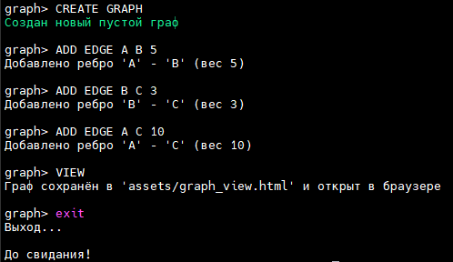
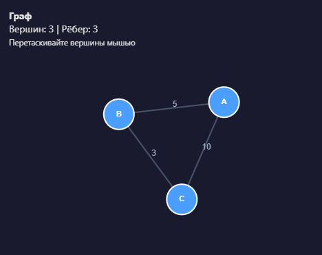

# Алгоритмы поиска на графах (Лабораторная работа №3)

Репозиторий содержит реализацию лабораторной работы №3 по курсу «Информатика (организация и поиск данных)» в НИЯУ МИФИ. Проект представляет собой комплекс графовых алгоритмов на неориентированных взвешенных графах с интерактивным консольным интерфейсом, интерактивной визуализацией в браузере и системой бенчмарков с выгрузкой результатов в CSV.

## Основные возможности

- **Слой данных**: неориентированный взвешенный граф на списках смежности. Вершины могут иметь строковые имена. Веса поддерживают целые и вещественные числа (принцип общности). Корректно обрабатываются петли и параллельные рёбра.
- **Алгоритмы кратчайших путей**:
  - **Обход в ширину (BFS)** — кратчайшие пути в невзвешенном графе за O(V + E);
  - **Дейкстра** — взвешенные графы с неотрицательными весами за O((V + E) log V), реализация с ленивым удалением из очереди с приоритетами;
  - **Форд-Беллман** — взвешенные графы за O(V·E), с обнаружением отрицательных циклов и ранней остановкой.
- **Алгоритмы минимального остова**:
  - **Крускал** — через систему непересекающихся множеств со сжатием путей и объединением по рангу;
  - **Прим** — через очередь с приоритетами;
  - оба алгоритма корректно строят **остовный лес** для несвязных графов.
- **Обходы и компоненты связности**: итеративные реализации обхода в глубину и в ширину на явном стеке/очереди — без переполнения стека на глубоких графах.
- **Генератор графов**: шесть топологий (случайный граф Эрдёша-Реньи, кольцо, путь, звезда, полный граф, случайное дерево) и три распределения весов (по возрастанию, по убыванию, случайное) — закрывает требование методички о трёх случаях входных данных. Детерминированность по зерну обеспечивает воспроизводимость бенчмарков.
- **Вспомогательные структуры данных**:
  - бинарная куча-минимум для Дейкстры и Прима;
  - система непересекающихся множеств для Крускала;
  - кольцевой буфер для обхода в ширину.
- **Бенчмарки**: измерение времени, сравнение нескольких алгоритмов на одном графе, полный прогон по всем топологиям и распределениям весов, выгрузка результатов в CSV.
- **Парсер команд**: разбор текстовых команд в абстрактное синтаксическое дерево, поддержка строковых литералов в кавычках и комментариев.
- **Визуализация графа**: генерация самодостаточной HTML-страницы с интерактивной силой-направленной раскладкой на Canvas — перетаскивание вершин, отображение весов рёбер, без внешних зависимостей.

## Демонстрация работы

### Интерактивный режим (консоль)


### Визуализация графа в браузере


## Сборка и запуск

### Требования
- Компилятор с поддержкой **C++20** (GCC 11+ или Clang 13+)
- ОС: Linux / macOS / WSL
- `xdg-open` для открытия визуализации в браузере (стандартно в большинстве дистрибутивов Linux)

### Скрипт управления

```bash
chmod +x c.sh

# Запуск тестов
./c.sh 1    # структура графа
./c.sh 2    # очередь с приоритетами
./c.sh 3    # система непересекающихся множеств
./c.sh 4    # BFS, DFS, компоненты связности
./c.sh 5    # Дейкстра, Форд-Беллман
./c.sh 6    # Крускал, Прим
./c.sh 7    # генератор графов
./c.sh 8    # слой бенчмарков
./c.sh 9    # парсер команд
./c.sh 10   # сквозные тесты (парсер + исполнитель)
./c.sh all  # все тесты

# Интерактивный режим
./c.sh 11
```

## Пример использования

```
graph> CREATE GRAPH
Создан новый пустой граф

graph> ADD EDGE Москва Тверь 170
Добавлено ребро 'Москва' - 'Тверь' (вес 170)

graph> ADD EDGE Тверь Новгород 390
Добавлено ребро 'Тверь' - 'Новгород' (вес 390)

graph> ADD EDGE Москва Новгород 600
Добавлено ребро 'Москва' - 'Новгород' (вес 600)

graph> ADD EDGE Новгород Псков 290
Добавлено ребро 'Новгород' - 'Псков' (вес 290)

graph> SHOW GRAPH
Граф:
  Вершин: 4
  Рёбер:  4
  Связный: да

graph> PATH DIJKSTRA Москва Псков
Алгоритм: DIJKSTRA
Путь: Москва -> Тверь -> Новгород -> Псков
Расстояние: 850.00

graph> SPANNING KRUSKAL
Алгоритм: KRUSKAL (минимальный остов)
Рёбра остова:
  Москва - Тверь (вес 170)
  Тверь - Новгород (вес 390)
  Новгород - Псков (вес 290)
Суммарный вес: 850.00

graph> GENERATE RANDOM 1000 5000 SEED 42
Сгенерирован граф: вершин=1000, рёбер=5000, топология=random, веса=random

graph> BENCHMARK SHORTEST v0
Результаты бенчмарка (3):
Алгоритм       | Время (мс) | Результат     | Статус
------------------------------------------------------------
DIJKSTRA       |      2.340 | 125000.00     | OK
BELLMAN-FORD   |     45.670 | 125000.00     | OK
BFS            |      0.890 | 45000.00      | OK

graph> EXPORT CSV assets/benchmark_results.csv
Результаты сохранены в 'assets/benchmark_results.csv' (3 строк)

graph> VIEW
Граф сохранён в 'assets/graph_view.html' и открыт в браузере
```

## Полный список команд

| Команда | Назначение |
|---|---|
| `CREATE GRAPH` | создать пустой граф |
| `ADD VERTEX [имя]` | добавить вершину |
| `ADD EDGE <от> <до> <вес>` | добавить ребро |
| `SHOW GRAPH / VERTICES / EDGES` | просмотр данных |
| `GENERATE <топология> <n> [m] [SEED s] [WEIGHTS ASC\|DESC\|RANDOM min max]` | генерация графа |
| `PATH BFS\|DFS\|DIJKSTRA\|BELLMAN <от> [до]` | кратчайший путь или обход |
| `SPANNING KRUSKAL\|PRIM` | минимальный остов |
| `COMPONENTS` | компоненты связности |
| `BENCHMARK SHORTEST <от>` | бенчмарк кратчайших путей |
| `BENCHMARK MST` | бенчмарк остова |
| `BENCHMARK SUITE <n> <m> [seed]` | полный набор бенчмарков |
| `EXPORT CSV <файл>` | выгрузка бенчмарка в CSV |
| `VIEW [файл]` | визуализация графа в браузере |
| `HELP` | справка по командам |
| `EXIT` / `QUIT` | выход |

## Структура проекта

```
3_laba/
├── c.sh                        # скрипт сборки и запуска
├── README.md
│
├── cli/
│   └── main.cpp                # интерактивный клиент (REPL)
│
├── core/
│   ├── Graph.h                 # неориентированный взвешенный граф
│   ├── GraphGenerator.h        # генератор графов шести топологий
│   ├── GraphQuery.h            # AST команд
│   ├── GraphParser.h           # парсер команд
│   ├── GraphExecutor.h         # исполнитель команд
│   ├── GraphViewer.h           # генератор интерактивной визуализации
│   ├── Benchmark.h             # слой бенчмарков и выгрузка в CSV
│   ├── PriorityQueue.h         # бинарная куча-минимум
│   ├── DSU.h                   # система непересекающихся множеств
│   ├── Queue.h                 # кольцевой буфер
│   │
│   └── algorithms/
│       ├── PathResult.h        # единый результат алгоритмов пути
│       ├── BFS.h               # обход в ширину
│       ├── DFS.h               # обход в глубину
│       ├── Dijkstra.h          # алгоритм Дейкстры
│       ├── BellmanFord.h       # алгоритм Форда-Беллмана
│       ├── MstResult.h         # единый результат остовных алгоритмов
│       ├── Kruskal.h           # алгоритм Крускала
│       └── Prim.h              # алгоритм Прима
│
├── lib/                        # базовые контейнеры и утилиты
│   ├── DynamicArray.h          # динамический массив (из ЛР-2)
│   ├── HashTable.h             # хеш-таблица с методом цепочек (из ЛР-2)
│   ├── Value.h                 # типизированное значение (из ЛР-2)
│   ├── Option.h                # Option<T> — альтернатива исключениям
│   └── Exceptions.h            # иерархия исключений
│
├── tests/                      # модульные и интеграционные тесты
│   ├── test_graph.cpp          # структура графа
│   ├── test_priority_queue.cpp # очередь с приоритетами
│   ├── test_dsu.cpp            # система непересекающихся множеств
│   ├── test_bfs_dfs.cpp        # BFS, DFS, компоненты связности
│   ├── test_shortest_paths.cpp # Дейкстра, Форд-Беллман
│   ├── test_mst.cpp            # Крускал, Прим
│   ├── test_generator.cpp      # генератор графов
│   ├── test_benchmark.cpp      # слой бенчмарков
│   ├── test_graph_parser.cpp   # парсер команд
│   └── test_executor.cpp       # сквозные тесты
│
└── assets/
    ├── screenshots/            # скриншоты для документации
    ├── scenarios/              # сценарии для демонстрации
    └── benchmark_results.csv   # результаты бенчмарков
```

## Связь с предыдущими лабораторными работами

Согласно методическим требованиям, в проекте **переиспользуются структуры данных из ЛР-2**:
- `DynamicArray<T>` — основа всех контейнеров проекта;
- `HashTable<K, V>` — хранение именованных вершин, детекция дубликатов рёбер в генераторе;
- `Value` — универсальный тип веса ребра, обеспечивающий принцип общности;
- подход к парсеру (токенизатор + разбор по первому ключевому слову) и исполнителю (разделение ответственности) повторяет архитектуру мини-СУБД из ЛР-2.

Также реализован собственный тип `Option<T>` — альтернатива исключениям для операций, где отсутствие результата является нормальной ситуацией (поиск ключа в хеш-таблице).

## Тестирование

Все алгоритмы покрыты модульными и интеграционными тестами:

| Набор | Что проверяет |
|---|---|
| `test_graph` | вершины, рёбра, списки смежности, имена, исключения |
| `test_priority_queue` | FIFO-порядок по приоритету, кольцевой буфер |
| `test_dsu` | объединение, сжатие путей, объединение по рангу |
| `test_bfs_dfs` | расстояния, порядок обхода, компоненты, глубокие графы (50000 вершин) |
| `test_shortest_paths` | Дейкстра против Форда-Беллмана (дифференциальный тест), Дейкстра против BFS на единичных весах, валидность путей |
| `test_mst` | Крускал против Прима на связных и несвязных графах, отрицательные веса, параллельные рёбра |
| `test_generator` | топологии, детерминированность, распределения весов |
| `test_benchmark` | сравнение результатов алгоритмов, выгрузка в CSV |
| `test_graph_parser` | корректный разбор и обработка ошибок |
| `test_executor` | полный сценарий: ручной ввод → алгоритм → результат |

Запуск всех тестов:

```bash
./c.sh all
```

## Авторы

- **Великанов М.Н.**
- Группа: Б25-507
- Учебное заведение: НИЯУ МИФИ
- Год: 2026

---
*Проект разработан в учебных целях в рамках курса «Информатика (организация и поиск данных)».*

---
